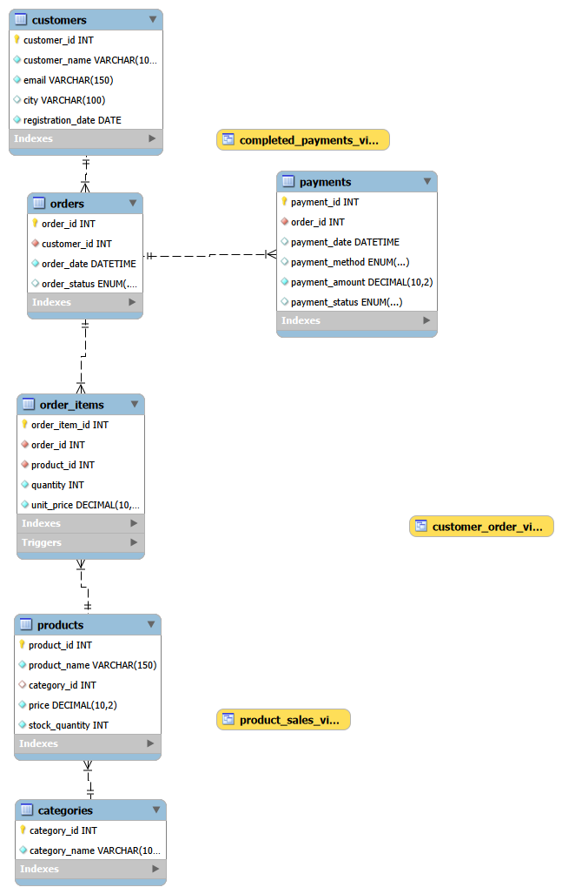

# E-commerce Sales Analytics Project

## Project Overview

This project is an E-commerce Sales Analytics database built using MySQL.

The project focuses on designing a relational database, inserting sample
e-commerce data, performing sales analytics, creating reusable database
objects, optimizing queries, and testing data integrity.

The database helps analyze customers, products, orders, payments,
sales performance, and inventory.

## Technologies Used

- MySQL 8.0
- MySQL Workbench
- SQL

## Database Structure

The database contains the following tables:

1. customers
2. categories
3. products
4. orders
5. order_items
6. payments

## Entity Relationship Diagram

The Entity Relationship Diagram (ERD) represents the relationships
between customers, products, categories, orders, order items, and payments.



## Project Structure

```text
ecommerce-sales-analytics/
│
├── README.md
├── er_diagram.png
├── ecommerce_analytics.mwb
│
├── screenshots/
│
└── sql/
    ├── 01_database_schema.sql
    ├── 02_insert_sample_data.sql
    ├── 03_basic_analytics.sql
    ├── 04_advanced_analytics.sql
    ├── 05_views_procedures_triggers.sql
    ├── 06_stored_functions.sql
    ├── 07_indexes_optimization.sql
    └── 08_data_integrity_testing.sql


    ## SQL Learning & Project Experience

I have successfully completed SQL learning from beginner to advanced level using MySQL. Throughout this learning journey, I gained practical knowledge of database design, data manipulation, joins, subqueries, aggregate functions, constraints, transactions, views, stored procedures, functions, triggers, indexing, and query optimization.

I applied these concepts by building an **E-commerce Sales Analytics Project**, where I designed a relational database, created tables and relationships, inserted sample data, and performed basic and advanced sales analytics. I implemented views, stored procedures, functions, indexing, and data integrity testing to improve database functionality and performance.

This project helped me strengthen my SQL knowledge through hands-on implementation and develop practical database management and data analysis skills. The complete project, including SQL scripts, ER diagram, screenshots, and MySQL Workbench model, is available in this repository.